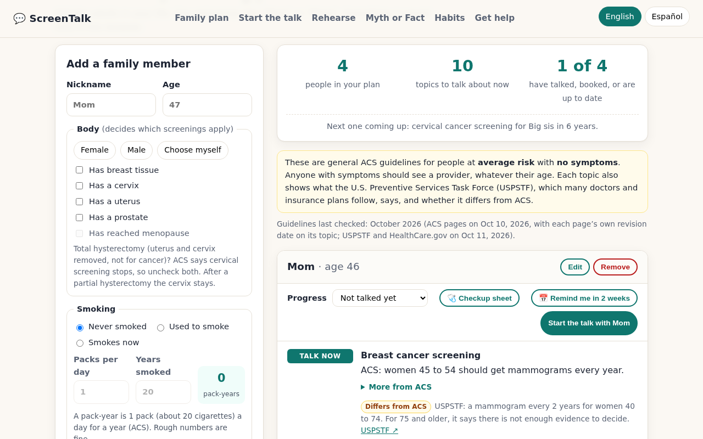

# ScreenTalk

**Live demo:** https://aariv.me/Screentalk/ · Spanish: https://aariv.me/Screentalk/?lang=es

ScreenTalk shows which cancer screening guidelines apply to each adult in your family and helps you bring it up with them.



*The finished family plan after one tap on "Load demo family" (made-up people). Real screenshot of the app at 1280 px, taken with headless Chromium on Oct 11, 2026.*

ScreenTalk is a free, private web app that helps teens turn the American Cancer Society (ACS) cancer screening guidelines into a plan for the adults in their family, then helps them bring it up and keep track of what happens next.

Built by Aariv Patel for the [2026 International CodeTheCure Hackathon](https://codethecure-hackathon-26.devpost.com/) · Track: **Prevention & Education**

> **Note:** ScreenTalk is an educational tool. It shares general ACS guidelines for people at average risk with no symptoms. It does **not** diagnose, estimate anyone's cancer risk, or replace a healthcare provider.

---

## The problem

Screening tests can find some cancers early, before symptoms, when they are easier to treat. ACS publishes clear guidelines on who should talk with a provider about which test and when. But the adults those guidelines are written for often put off checkups. Teens learn about health at school and often look things up for their families, yet have no easy way to turn that knowledge into action at home.

## Features

| Feature | What it does |
|---|---|
| **Family screening plan** | Add family members by nickname and age (no names, no accounts). For each person, ScreenTalk shows which ACS guideline topics apply, labeled **Talk now**, **Discuss** (a shared decision), **Coming up** (with years until it starts), or **Good to know**. Covers breast, colorectal, cervical, endometrial awareness, lung, prostate, and the HPV vaccine. |
| **USPSTF cross-check** | Every screening topic also shows what the U.S. Preventive Services Task Force says, with a *Same as ACS* / *Differs from ACS* chip and a link (breast 2024; colorectal and lung 2021; cervical and prostate 2018, updates in progress). |
| **What it costs** | Where it applies, a line saying most health plans must cover the screening with no copay or deductible from an in-network provider ($0 not guaranteed), citing HealthCare.gov (CuidadoDeSalud.gov in Spanish). |
| **Start the talk from a card** | A *Start the talk with Mom* button on each person jumps straight to a written conversation starter for that person. |
| **Pack-year helper** | Packs per day × years smoked, the measure ACS uses for lung screening (ages 50 to 80, 20+ pack-years, smokes now or used to). |
| **Questions for the checkup** | Each person gets a short list of questions to ask a provider, based on their topics. |
| **Progress tracker** | Mark each person *Not talked yet → We talked → Checkup booked → Up to date*. The summary shows how many have moved forward. |
| **Calendar reminder** | One tap downloads a 2-week "check in with Mom" reminder (.ics), made on the device. |
| **Family timeline** | An SVG chart of each person's screening windows. Solid = ACS recommends it; lighter = a choice to discuss. ▼ marks their age today. Includes a text version for screen readers. |
| **Conversation starters** | A casual, heartfelt, or text-message opener naming the exact topics. Edit it so it sounds like you, then copy or share. Tips for awkward talks. A "Write it in" switch writes the message and the printed checkup sheet in English or Spanish whatever the app language is, for a parent who reads a different language than the teen. |
| **Rehearse the talk** | A practice conversation with a parent (Mom, Dad, Grandma, or Grandpa) who pushes back five times: "I feel fine," "no family history," "scared of a colonoscopy," "too expensive," and "no time." Pick one of three replies; the parent reacts with a scripted line, an openness meter moves, and the next pushback opens warmer or more guarded depending on how it went. Every reply gets a coaching tip citing ACS, NCI, or CDC. Ends with a score out of 10, how the parent responds, and a round-by-round review with a better line to try. English and Spanish, keyboard-friendly (Tab/Enter or keys 1 to 3), works on phones. |
| **Myth or Fact** | A 12-card game using claims from NCI's Common Cancer Myths page and ACS guidance, with an explanation and source for every answer. |
| **Habits** | The ACS "Take control of your health" steps as a checklist teens can commit to. |
| **Get help** | ACS 24/7 helpline, NCI Cancer Information Service, how to get screened without a doctor, NBCCEDP, Vaccines for Children, free quit-tobacco help. |
| **One-page checkup sheet** | Print a single sheet per person to take to the appointment: the ACS topics to bring up, blanks for last test date, result, and next due, the questions to ask with checkboxes, pack-years for lung screening, a family-history table, and lines for what the provider said. Each topic row also carries the USPSTF cross-check (Same as / Differs from ACS) and a "No copay*" tag where HealthCare.gov's no-copay rule applies, with one footnote under the table. In print the topic column is wider and spacing is tighter (body text stays at 8.5pt or larger), so every demo-family person's sheet fits on one Letter page in both English and Spanish, and a browser test checks each one. |
| **Print / save as PDF** | A clean printout of the whole family plan. |
| **English and Spanish** | One switch (top of the page, or `?lang=es` in the link) turns the whole app into neutral Latin American Spanish: the plan, the guideline text, the timeline, the message builder, the printed checkup sheet, the game, habits, help, and sources. Medical terms follow the CDC and NCI Spanish pages ([docs/glossary-es.md](docs/glossary-es.md)); each topic also links a CDC Spanish page. A native-speaker review is still pending, and the app says so. |

## Responsible design

- **Education, not diagnosis.** The app never says someone "needs" a test and never calculates risk. Every item is framed as a topic to discuss with a healthcare provider. A unit test scans all generated text for diagnostic or risk-score language.
- **Every fact is sourced.** Each plan item links to the ACS page it summarizes. Every Myth-or-Fact card links to NCI or ACS. Every rehearsal coaching tip links to the ACS, NCI, or CDC page behind it. All content was re-checked against the live pages on October 10, 2026 (see table below). The plan and the printed checkup sheet say so in English and Spanish: "Guidelines last checked: October 2026", with each topic's ACS revision date (ACS checked Oct 10, 2026; USPSTF and HealthCare.gov Oct 11, 2026).
- **Private by design.** No accounts, no server, no analytics, no cookies, no fonts or scripts from other sites. A Content-Security-Policy blocks network connections entirely, and the end-to-end test confirms the page makes zero network requests. Data stays in the browser's `localStorage`; "Clear all data" wipes it.
- **Works offline.** After one online visit, a small service worker (`sw.js`) keeps a copy of ScreenTalk's own files, so the app and the checkup sheet still open with no signal (say, in a clinic waiting room). It always tries the network first, so a new version wins whenever you are online, and it stores nothing from other sites.
- **Inclusive.** Screenings are chosen by body (breast tissue, cervix, uterus, prostate) as well as Female/Male presets, while keeping ACS's own wording.
- **Accessible.** Keyboard-friendly, visible focus, labeled controls, live announcements, screen-reader text for the chart, WCAG AA color contrast, reduced-motion support, works at 360 px wide.

## How each guideline is applied

| Topic | Rule in ScreenTalk | ACS page (last revised) |
|---|---|---|
| Breast | 40–44 choice to start yearly mammograms; 45–54 yearly; 55+ every 2 years or yearly, while in good health with 10+ years' life expectancy | [Breast cancer early detection](https://www.cancer.org/cancer/types/breast-cancer/screening-tests-and-early-detection/american-cancer-society-recommendations-for-the-early-detection-of-breast-cancer.html) (Jul 23, 2026) |
| Colorectal | Average risk: start at 45, through 75; 76–85 discuss; over 85 stop. Stool, visual, and (not preferred) blood-based options with intervals | [Colorectal screening recommendations](https://www.cancer.org/cancer/types/colon-rectal-cancer/detection-diagnosis-staging/acs-recommendations.html) (May 27, 2026) |
| Cervical | Cervix: 25 to at least 65; primary HPV test every 5 years preferred; exit rules after 65 | [Cervical screening guidelines](https://www.cancer.org/cancer/types/cervical-cancer/detection-diagnosis-staging/cervical-cancer-screening-guidelines.html) (Dec 4, 2025) |
| Endometrial | Uterus + menopause: know the risks and symptoms; report unexpected bleeding | [Endometrial cancer early detection](https://www.cancer.org/cancer/types/endometrial-cancer/detection-diagnosis-staging/detection.html) (Feb 28, 2025) |
| Lung | 50–80, smokes now or used to, 20+ pack-years: yearly low-dose CT after a talk about benefits and harms; quit help for current smokers. ACS has no years-since-quitting limit; an optional "years since quitting" field shows whether the USPSTF 15-year rule (and the no-copay line) applies | [Lung cancer early detection](https://www.cancer.org/cancer/types/lung-cancer/detection-diagnosis-staging/detection.html) (Jan 29, 2024) |
| Prostate | Informed-decision talk at 50; 45 if African American or one father/brother diagnosed before 65; 40 if more than one | [Prostate early detection recommendations](https://www.cancer.org/cancer/types/prostate-cancer/detection-diagnosis-staging/acs-recommendations.html) (Nov 22, 2023) |
| HPV vaccine | 2 doses at 9–12; 13 through 26 not fully vaccinated: as soon as possible | [HPV vaccines](https://www.cancer.org/cancer/risk-prevention/hpv/acs-recommendations-for-hpv-vaccine-use.html) (Sep 3, 2026) |

Summary page: [ACS Guidelines for the Early Detection of Cancer](https://www.cancer.org/cancer/screening/american-cancer-society-guidelines-for-the-early-detection-of-cancer.html) (May 27, 2026). Myth or Fact: [NCI Common Cancer Myths and Misconceptions](https://www.cancer.gov/about-cancer/causes-prevention/risk/myths).

ScreenTalk is not affiliated with or endorsed by ACS or NCI. Guidelines are for the United States.

## Tech

- Plain HTML, CSS, and JavaScript. No framework, no build step, no paid APIs, no dependencies.
- `js/rules.js`: a pure, testable rules engine that maps a profile to ACS guideline topics and timeline segments (runs in the browser and in Node).
- `js/content.js`: conversation starters, checkup questions, Myth-or-Fact cards, habits, resources, saved-data cleaning, the .ics builder, and the checkup-sheet data.
- `js/app.js`: UI, `localStorage`, SVG timeline, game, progress tracker, checkup sheet.
- `js/rehearse.js`: the rehearsal script (English and Spanish), sources, and a pure engine for branching and scoring (runs in the browser and in Node).
- `js/rehearse-ui.js`: the rehearsal UI.
- `js/i18n.js`: page language (English/Spanish), the UI strings in both languages, and `data-i18n` attributes in `index.html`. Same pattern as the rehearsal: `STRINGS[lang][key]` with `{placeholders}`. `rules.js` and `content.js` take a language argument (`evaluate(person, 'es')`).
- `tests/rules.test.js`: 43 zero-dependency Node tests (it also runs `tests/rehearse.test.js`, 17 tests: every tip cites ACS/NCI/CDC, both languages complete, branching, scoring, endings; and `tests/i18n.test.js`, 21 tests: English and Spanish have the same keys and placeholders everywhere, the Spanish plan has the same topics, statuses, and ages at every age 0–120, CDC/NCI Spanish terms are used consistently, the Spanish checkup sheet and starters are complete) covering every guideline boundary (for example colorectal 44/45/75/76/85/86, lung 19.9 vs 20 pack-years and 15 vs 16 years since quitting, prostate 40/45/50), every age 0–120, banned diagnostic language, saved-data cleaning, calendar files, and checkup-sheet data.
- `tests/sw.test.js`: 11 tests for the offline service worker (it caches every file the page loads, answers from the network first and from the cache only when offline, deletes only old ScreenTalk caches, registers only over http(s), CSP still blocks other sites) and the link preview (a real 1280x800 screenshot whose caption numbers are re-computed from the rules).
- `tests/e2e_test.py`: 246 browser checks with Playwright: an untouched demo family renames itself when the language switches, validation, add/edit/remove, progress after reload, starters, copy, the whole game by keyboard, the rehearsal by keyboard in English and Spanish (perfect and weak runs, branching, 390 px layout), reminder download, the years-since-quitting field (USPSTF 15-year rule and no-copay line at 15 and 16 years, English and Spanish, validation, saved-data cleaning; the demo family's Dad quit 18 years ago, so his lung card shows "Differs from ACS" with no no-copay line), the "Guidelines last checked: October 2026" line and per-topic ACS revision dates on the plan and sheet (English and Spanish), the printable checkup sheet (USPSTF line and no-copay tag on every row, fits on one Letter page in English and Spanish), every demo-family person's sheet in both languages (one Letter page with at least 40 px to spare, title, topic rows, questions, sources and guidelines-checked line, disclaimer, body text 8.5pt or larger), clearing data, broken saved data, mobile layout (44 px section-link tap targets, 24 px+ "More from ACS" toggles, a nav edge fade only while links are off-screen, no visible text under 12 px in English or Spanish), the whole app in Spanish (plan, message, printed sheet in print mode, game, habits, help, footer, `?lang=es`, 390 px), WCAG AA text contrast on every visible element in both languages, offline (served over http, the service worker takes control, then with the connection cut the page reloads, the demo family loads and `?lang=es` opens in Spanish), zero console errors, zero network requests when opened from disk.
- `docs/quality-log.md`: what each review round found and fixed.

```
screentalk/
├── index.html
├── css/styles.css
├── js/rules.js      # guideline engine
├── js/content.js    # starters, questions, myths, resources, helpers
├── js/app.js        # UI
├── js/rehearse.js   # rehearsal script + engine (EN/ES)
├── js/rehearse-ui.js
├── js/i18n.js       # page language + UI strings (EN/ES)
├── sw.js            # offline copy of the app's own files (network first)
├── tests/rules.test.js
├── tests/rehearse.test.js
├── tests/i18n.test.js
├── tests/sw.test.js
├── tests/devpost-claims.test.js
├── tests/uspstf-audit.test.js
├── tests/resources.test.js
├── tests/links.test.js
├── tests/docs.test.js
├── tests/e2e_test.py
├── tests/edge_test.py
├── tests/axe_states_test.py
├── tests/axe_baseline_test.py
├── docs/glossary-es.md
└── docs/quality-log.md
```

## Run it

Open `index.html` in any modern browser. That's it.

Unit tests (Node 18+):

```bash
node tests/rules.test.js     # 127 tests: 43 rules/content (incl. USPSTF cross-check, no-copay ranges, the 15-year quit rule, and a source URL plus revision/check date for every topic) + 17 rehearsal + 21 English/Spanish + 11 offline service worker and link preview (Open Graph image is a real 1280x800 screenshot of the finished demo-family plan; caption numbers re-computed from the rules) + 11 Devpost-claims checks (every guideline, count and feature claim on the submitted page, re-checked against the code) + 7 USPSTF primary-source checks (every age range and interval re-read on the current USPSTF final statements on Oct 11, 2026, and the Same/Differs chip at each published edge) + 7 free-resource checks (`tests/resources.test.js`: the NBCCEDP card keeps its 40–64 / 21–64 ages, income/insurance condition and "state rules vary" hedge in English and Spanish, the VFC card keeps "under 19" / "menores de 19", the quit-tobacco card keeps ACS Empowered to Quit + 1-800-227-2345 in English and the NCI Spanish/English quit line 1-877-448-7848 in Spanish (sources re-read Oct 12, 2026), English and Spanish stay in step, and long text cannot widen the 390 px grid) + 5 link-hygiene checks (`tests/links.test.js`: every link in the page and the app code is https, an in-page anchor or tel:, and every new-tab link carries rel="noopener") + 5 README/docs checks (`tests/docs.test.js`: every relative link and file path named in this README and docs/ exists, the file tree lists every test file, and the unit-test counts quoted here match the real suites)
```

Browser tests (optional):

```bash
pip install playwright && playwright install chromium
python3 tests/e2e_test.py    # 246 checks; CHROME_PATH=/usr/bin/chromium to use a system Chromium
python3 tests/edge_test.py        # 65 checks at 390 px: each form error (nickname, age 121 / 47.5, no body choice, 11 packs/day, quit + smoked > age) is re-worded, not dropped, when you switch EN/ES, with the same field still marked and focus left on the language button; edit mode, rehearsal round, game card and score kept across a switch; ages 0/120 saved, 121/-1 refused; 10 vs 10.25 packs; 30 people with no sideways scroll
python3 tests/axe_baseline_test.py  # 12 checks: WCAG 2.2 AA + best-practice axe-core guard at 360/1280 px, incl. target-size (WCAG 2.5.8, off by default in axe): fails only on a serious/critical violation not in the Oct 12, 2026 audit baseline
python3 tests/axe_states_test.py  # 224 checks: axe-core 0 violations in 11 states (empty, form errors, demo family, editing, starter, high-risk person, rehearsal question/feedback/result, game feedback/end) x 390/1280 px x EN/ES, again after switching language mid-flow
```

Last run Oct 12, 2026: **127/127 unit tests passing (re-run Oct 12 after the last change) and 246/246 browser checks passing (Chromium, run earlier Oct 12)**. GitHub Actions (`.github/workflows/tests.yml`) runs both suites on every push to `main`.

### Deploy on GitHub Pages

Repo **Settings → Pages → Build and deployment → Deploy from a branch → `main` / `(root)` → Save**. The site is served at `https://aariv.me/Screentalk/` (custom domain for `draarivpatel-ui.github.io`).

## Data sources

- **Guidelines:** American Cancer Society screening pages, one per topic, linked with their last-revised dates in the table above.
- **Cross-check:** USPSTF recommendation pages for breast, colorectal, cervical, lung, and prostate cancer screening; **cost:** HealthCare.gov preventive care for adults and for women (checked Oct 11, 2026).
- **Myth or Fact:** NCI *Common Cancer Myths and Misconceptions* and ACS guidance. **Rehearsal tips:** ACS, NCI and CDC pages, each cited in the app.
- **Free vaccines for kids and teens:** the "under 19" age on the Vaccines for Children card comes from the CDC *About the Vaccines for Children (VFC) Program* page (eligible children "ages 18 or younger", page reviewed Aug 27, 2026, re-read Oct 12, 2026); the card's Spanish link is the CDC HPV Spanish page, which names the program and the 800-232-4636 line but not the age.
- **Spanish medical terms:** CDC and NCI Spanish pages ([docs/glossary-es.md](docs/glossary-es.md)).
- **Statistic on the home page:** CDC (2022 colorectal screening rate, linked in the app).
- All of it is written into the app's code; the app makes **no requests to other sites** at runtime (it only loads its own files, which `sw.js` keeps for offline use).

## Limits

- Covers the ACS average-risk guidelines in the US. People at higher risk are pointed to a provider rather than given a plan.
- English and Spanish. The Spanish has not yet been reviewed by a native speaker.
- Saved family members and progress live only in this browser's `localStorage`, with no export yet. On Safari (iPhone, iPad, Mac), WebKit deletes a site's LocalStorage and service-worker cache "after seven days of Safari use without user interaction on the site" ([WebKit](https://webkit.org/blog/10218/full-third-party-cookie-blocking-and-more/)), so a family plan not opened for a week of Safari use can disappear. Adding ScreenTalk to the Home Screen avoids this (WebKit does not expect Home Screen web apps to be affected), and the printed checkup sheet is a paper copy.
- Not yet reviewed by a clinician or health educator.

## AI assistance

This project was built with help from an AI assistant (Hark), which drafted code, tests and copy under Aariv Patel's direction. The app calls no AI service: the plan comes from a rules engine that encodes the ACS guidelines, the rehearsal parent's lines are scripted, and every fact links to its ACS, NCI or CDC source.

The demo video (submitted Oct 11, 2026) was also made with Hark: the narration is a synthetic text-to-speech voice (Microsoft Edge neural TTS, en-US-Andrew) reading a Hark-drafted script, over screen recordings of the live app with the made-up demo family. Its test counts (72 unit, 156 browser) were true when it was recorded; the current counts are in **Tech** and **Run it**.

## What's next

- A native-speaker review of the Spanish, then more languages (ACS publishes materials in many languages).
- Review of the content by a health educator or clinician.
- Running "ScreenTalk nights" with school health classes, libraries, and youth groups, and measuring how many families report a conversation or a booked checkup.

## Third-party licences

ScreenTalk ships no third-party code, fonts, images or data files: it uses system fonts, its own CSS and JavaScript, and loads nothing from other sites. The guideline, myth and glossary content is written in the project's own words from the ACS, USPSTF, NCI, CDC and HealthCare.gov pages listed above, and each fact links to its source rather than copying the page. Test tooling only (runs in CI, never shipped to users): Playwright (Apache-2.0) and axe-core (MPL-2.0). Checked Oct 13, 2026.

## License

MIT. See [LICENSE](LICENSE).
